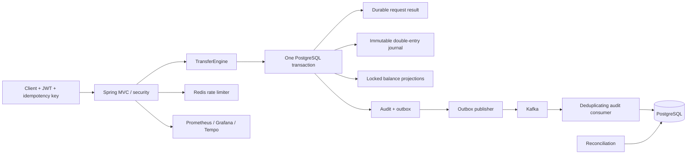

# LedgerCore

**A transaction-safe, auditable financial ledger and money movement engine.**

LedgerCore is simulated financial infrastructure for studying correctness under
concurrency and failure. It handles **no real money, cards, banking credentials or
external payment rails**. It is an educational reference implementation, not a
certified banking product.

An HTTP request can disappear after a database commit. Two requests can race to
spend the same funds. An event broker can be unavailable after a transfer succeeds.
LedgerCore makes those boundaries explicit and tests their financial consequences.



Java 21, Spring Boot 3.5.16, MVC, Data JPA/Hibernate for identities, explicit JDBC
for financial locking and SQL, PostgreSQL/Flyway, Spring Security JWT/BCrypt,
Redis, Kafka, Micrometer/OpenTelemetry, OpenAPI and Testcontainers. Versions are
pinned in `pom.xml` and Compose; the Boot BOM controls transitive library versions.
The JDBC and JPA adapters share the Spring-managed datasource and transaction manager.

The financial core supports INR and USD with two decimal places, simulated deposits,
internal transfers, status queries, administrator reversals, ledger-derived balances,
paginated statements, durable success and insufficient-funds replay, independent
reconciliation and recoverable asynchronous audit projections.

## Start locally

Install Docker Desktop (Linux containers) or Docker Engine with Compose. Ports
8080, 3000 and 9090 must be free; override `API_PORT`, `GRAFANA_PORT` and
`PROMETHEUS_PORT` in `.env` when needed.

```sh
git clone https://github.com/EklavyaGoyal17/LedgerCore.git
cd LedgerCore
docker compose up --build -d --wait --wait-timeout 300
python scripts/demo.py
```

Use `python3` where required. Compose contains clearly labeled local simulation
defaults, so it starts without creating `.env`. For customization, copy `.env.example`
to `.env` (`Copy-Item .env.example .env` in PowerShell; `cp` on macOS/Linux) and
replace the example passwords and JWT secret. Native `mvn spring-boot:run` requires
`DATABASE_URL`, `DATABASE_USER`, `DATABASE_PASSWORD`, `JWT_SECRET`, `REDIS_HOST`
and `KAFKA_BOOTSTRAP_SERVERS` pointing to reachable infrastructure. Compose keeps
database, Redis, Kafka and tracing ports private to its network by default.

- Swagger: http://localhost:8080/swagger-ui/index.html
- OpenAPI JSON: http://localhost:8080/v3/api-docs
- Readiness: http://localhost:8080/actuator/health/readiness (database required)
- Metrics: http://localhost:8080/actuator/prometheus
- Grafana: http://localhost:3000 (`admin` / `local-grafana-change-me` in local defaults)
- Prometheus: http://localhost:9090

Default simulated administrator: `admin@ledgercore.local` /
`local-admin-password-change-me`. Bootstrap creates the admin only if that email
does not exist. Changing the environment password does not reset an existing user.
No route allows a caller to select an administrative role at registration.

Stop with `docker compose down`. Named volumes preserve data across restarts.
`docker compose down -v` permanently removes this project's simulated data; use it
only when intentionally resetting the demo.

## Try the API

```http
POST /api/v1/auth/register
Content-Type: application/json

{"email":"alice@example.invalid","password":"Example-password-123!"}
```

Log in with the same body at `/api/v1/auth/login`; use `accessToken` as
`Authorization: Bearer <token>`. Create an account with
`POST /api/v1/accounts {"currency":"INR"}`. As the administrator, fund it:

```http
POST /api/v1/admin/simulated-deposits
Authorization: Bearer <admin-token>
Idempotency-Key: demo-funding-001
Content-Type: application/json

{"accountId":"<account-uuid>","amount":"1000.00","currency":"INR"}
```

As the source owner, transfer to another account:

```http
POST /api/v1/transfers
Authorization: Bearer <owner-token>
Idempotency-Key: demo-transfer-001
Content-Type: application/json

{"sourceAccountId":"<source-uuid>","destinationAccountId":"<destination-uuid>","amount":"500.00","currency":"INR"}
```

A successful request returns HTTP 201 with transfer UUID, journal UUID and
`COMPLETED`. Repeating the request with the same key returns the same status and
JSON values. A different payload using that key returns 409. Insufficient funds
returns 422 Problem Details with a queryable failed transfer ID. A timeout means
**unknown outcome**: query `/api/v1/transfers/{id}` if known, or retry the original
key. Technical failures roll back; business insufficient-funds outcomes remain
durable. Validation/authorization errors do not consume a key.

View `GET /api/v1/accounts/{id}/balance` and `/statement?offset=0&limit=50`.
Reversals at `POST /api/v1/transfers/{id}/reversals` require administrator role
and a new idempotency key. Reversals fail if the original recipient has spent
the funds; they never create an overdraft. Simulated deposits are not reversible
through this endpoint. See [API semantics](docs/api/semantics.md).

## Build and verify

Install a **JDK 21** and Maven 3.9+. Set `JAVA_HOME` to JDK 21. Docker must be running
for integration tests. Tests intentionally fail rather than silently skip when
Docker is missing.

```sh
mvn spotless:apply      # only needed after editing Java
mvn test               # domain/unit tests
mvn clean verify       # format check, unit + real infrastructure tests, coverage, jar
docker compose config --quiet
```

Reports: `target/surefire-reports`, `target/failsafe-reports`,
`target/site/jacoco/index.html`. The jar is `target/ledgercore-1.0.0.jar`.
The integration suite uses isolated PostgreSQL, Kafka and Redis Testcontainers;
it never targets the Compose database. Docker API 1.44 is specified in the test
resources for compatibility with recent Docker engines.

`LedgerCoreIT` repeats ₹1,000 / two simultaneous ₹800 withdrawals ten times,
races identical requests, sends opposite-direction transfers, injects precommit
and postcommit failures, verifies database immutability and exercises real login.
`EventInfrastructureIT` pauses Kafka/Redis, simulates lost publication acknowledgment,
tests redelivery and durable consumer deduplication. Generated financial sequences
use fixed seeds for repeatability. [Verification evidence](docs/VERIFICATION.md)
distinguishes executed checks from configured checks. CI is configured; a local
build is not proof that GitHub Actions ran.

## Explore the repository

| Location | Purpose |
|---|---|
| `src/main/java/com/ledgercore/identity` | JPA identity persistence, registration/login |
| `accounts` | Customer account ownership, balances and statement queries |
| `ledger/domain` and `ledger/JournalPosting` | Exact money, journal validation, posting |
| `transfers/application` | Transaction boundary, locks, durable idempotency |
| `events` | Audit/outbox writes, acknowledged publisher, deduplicating consumer |
| `reconciliation` | Independent read-consistent checks and persisted reports |
| `security`, `observability`, `common` | JWT, rate limits, traces, errors, correlation |
| `src/main/resources/db/migration` | Schema, indexes, deferred invariant triggers |
| `src/test` | Domain, real database, security and outage tests |
| `infrastructure` | Prometheus, Grafana dashboard, Tempo |
| `scripts`, `load-tests` | API acceptance demo and k6 workloads |
| `docs/adr`, `docs/learning` | Engineering decisions and guided study |

## Engineering decisions and limits

Customer balances are credit-normal liabilities. Deposits debit a simulated
settlement asset and credit the customer liability; internal transfers debit the
source liability and credit the destination liability. Every posted journal
balances. Projections speed overdraft decisions, while journal entries remain the
authority. PostgreSQL checks projection equality at commit and denies later edits
or appends to committed journals.

READ COMMITTED plus account row locks prevents concurrent overspending. Account
UUIDs are sorted in Java and locked in separate statements. Transient lock
acquisition failures retry at most twice outside the complete transaction.
Reconciliation uses REPEATABLE READ for a coherent database snapshot.

Outbox delivery is **at least once**. Publication acknowledgment and a database
mark cannot be atomic across Kafka/PostgreSQL. The consumer commits its processed
event ID and audit projection together, then Kafka can acknowledge. Retries
therefore preserve one projection effect. Kafka does not participate in financial
posting. The implementation does not promise global event ordering.

Redis has a 60-second fixed-window rate limit using atomic Lua increment/expiry.
Authentication fails closed on Redis loss; authenticated financial traffic fails
open. Redis stores no financial truth. No financial balance cache is used.

This is a single-region educational deployment. Local database credentials own the
schema for Flyway; production needs separate migration/runtime roles, TLS, managed
secrets and key rotation, backups/PITR, replication, retention design, external
security review and incident procedures. Metrics are public inside the local
loopback deployment; restrict their ingress before exposing a deployment.
JWTs expire after 15 minutes; there is no refresh-token or MFA flow. See
[threat model](docs/architecture/security.md), [architecture and guarantees](docs/architecture/design.md),
[failure runbook](docs/failure-scenarios/recovery.md) and [index trade-offs](docs/architecture/database.md).

## Learn and extend

Start with `Money` and `Journal`, then the migration, `TransferEngine`, `Idempotency`,
and the concurrency tests. Continue with JWT/ownership, outbox delivery and
reconciliation. The [14 learning guides](docs/learning/README.md) connect concepts
to actual classes, examples and failure experiments. The
[interview workbook](docs/learning/interview-questions.md) contains more than 30
implementation-specific questions and answers.

Next worthwhile extensions are runtime database least privilege, automated
backup/restore exercises, key rotation with asymmetric signing, measured query
optimization, bounded reconciliation batches, outbox archival and poison-event
operations. Add external payment rails only as a separate, explicitly designed
project; this system is a simulation.
